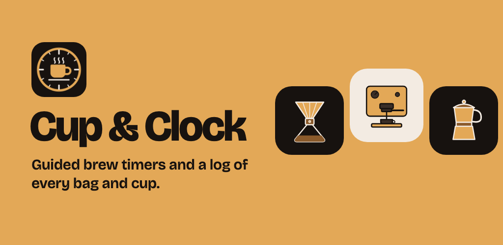

{: w="1024" h="500" }

**A better cup at home.** Cup & Clock guides you through each brew step by step, adjusts recipes to your cup size and taste, and keeps a log of your beans and every cup you rate.

> Coming soon to Google Play, with iOS to follow.
{: .prompt-info }

## What it does

- **Guided brew timers.** Each step is timed, with a sound or vibration when the next one starts and when the brew is done.
- **Recipes that fit your cup.** Scale a recipe to how much you want to make, tweak it to your taste, and save your favorites.
- **A bag log.** Track your beans: roaster, origin, roast date, and how much is left.
- **A cup log.** Rate each cup, add flavor tags and notes, and see what worked.

## Your data

Everything stays on your phone. Cup & Clock has no account, doesn't connect to the internet, and has no ads, analytics or tracking. Read the [privacy policy](/cup-and-clock/privacy/).

## Details

- **Platform:** Android, iOS coming soon
- **Built with:** Kotlin Multiplatform, Compose Multiplatform, Room, DataStore, Koin

## Support

Found a bug or have an idea? Email me at [{{ site.social.email }}](mailto:{{ site.social.email }}?subject=Cup%20%26%20Clock).
