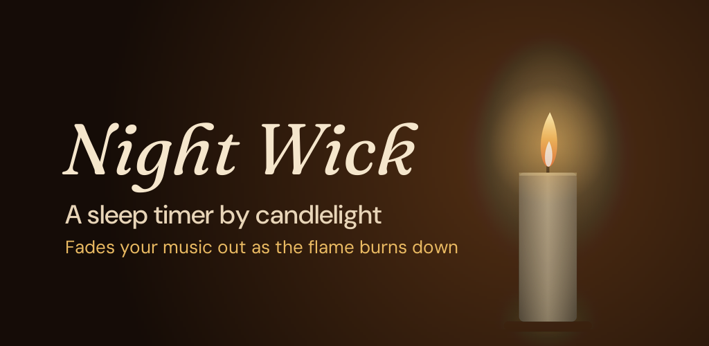

{: w="1024" h="500" }

**A sleep timer by candlelight.** Hold to light the candle, and it burns down while you drift off. Over the last ten minutes it gently fades out whatever you're listening to, then pauses it.

> Coming soon to Google Play.
{: .prompt-info }

## What it does

- **Works with any app.** Podcasts, audiobooks, music or videos fade out and pause when the candle goes out.
- **A gentle fade.** The volume lowers slowly over the last ten minutes, so the end doesn't wake you.
- **Turns the screen off** when the timer ends, if you want it to.
- **A bedside candle.** A dim, warm light for the nightstand.
- **A soft wake alarm** that starts quiet and rises.

## Your data

Night Wick has no internet access, no account, no ads and no analytics. Your settings stay on your phone. Read the [privacy policy](/night-wick/privacy/).

## Details

- **Platform:** Android
- **Built with:** Kotlin Multiplatform, Compose Multiplatform, Android foreground services and AlarmManager

## Support

Found a bug or have an idea? Email me at [{{ site.social.email }}](mailto:{{ site.social.email }}?subject=Night%20Wick).
