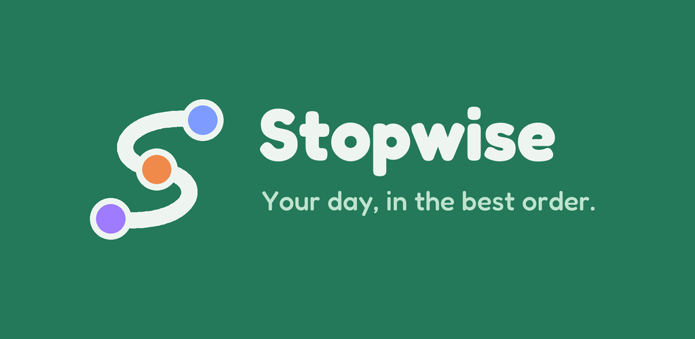

{: w="1024" h="500" }

**Your day, in the best order.** Add your appointments, errands and meet-ups, and Stopwise works out the order that wastes the least time, shows the route on a map and tells you when to leave.

> Coming soon to Google Play.
{: .prompt-info }

## What it does

- **Puts your stops in the best order.** Fixed-time appointments stay where they are, and everything else fits around them.
- **Shows the whole day on a map,** with how long each trip takes by walking, driving or transit.
- **Tells you when to leave,** with a reminder before each trip.
- **Suggests a closer branch** of a pharmacy, bank or shop when one is on your way.
- **Keeps errands for the right day.** Errands without a deadline wait for a day when they fit your route.
- **Re-plans on the go.** Once you're out, it plans the rest of the day from where you are.
- **Hands off to your maps app.** Open directions in Google Maps, 2GIS or Yandex Maps, or share a meet-up or add it to your calendar.

## Your data

No account, no ads and no server of its own. Your plans stay on your phone. To find places and work out routes, Stopwise uses Google Maps Platform. The [privacy policy](/stopwise/privacy/) explains exactly what is sent.

## Details

- **Platform:** Android
- **Built with:** Kotlin Multiplatform, Compose Multiplatform, SQLDelight, Google Maps Platform (Places, Routes, Maps SDK)

## Support

Found a bug or have an idea? Email me at [{{ site.social.email }}](mailto:{{ site.social.email }}?subject=Stopwise).
